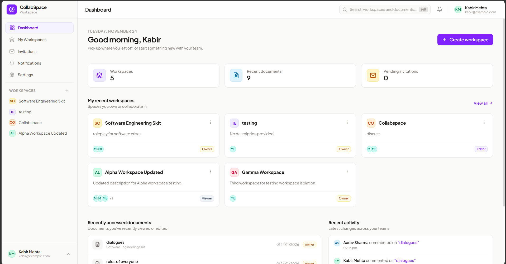
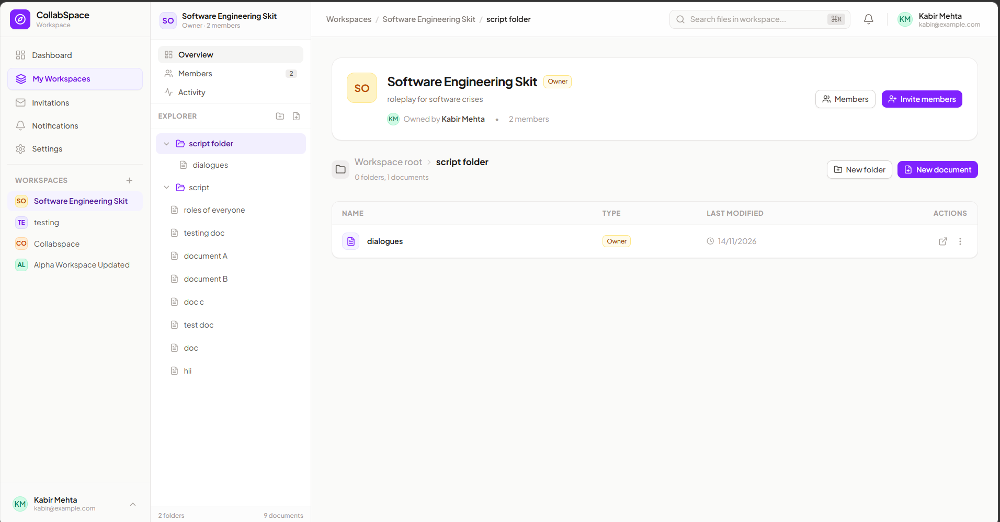
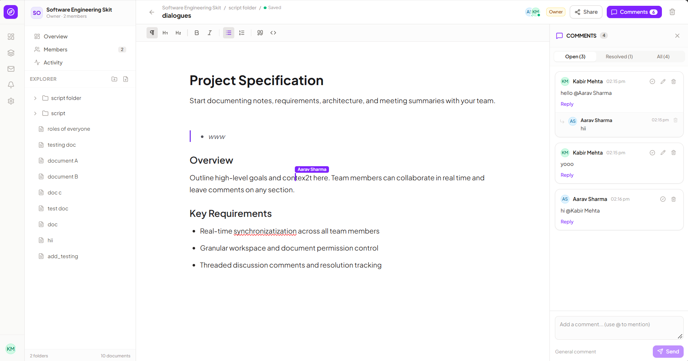
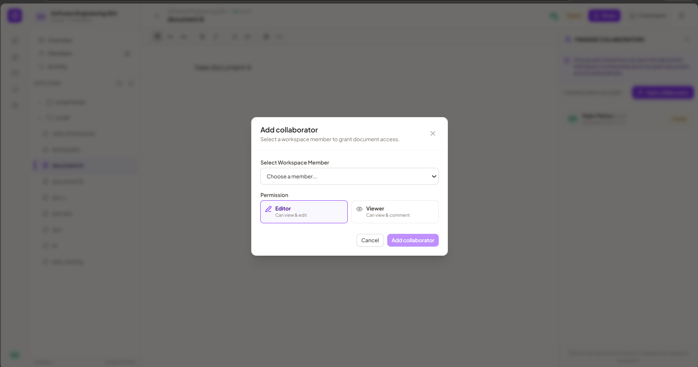
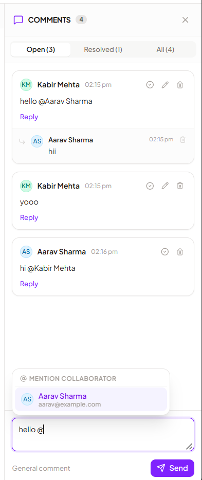

# 🚀 CollabSpace – Collaborative Knowledge Workspace

A full-stack collaborative knowledge management platform that enables teams to create shared workspaces, organize documents, and collaborate in real time. Built to provide a centralized environment for team communication, document management, and knowledge sharing, CollabSpace combines real-time synchronization, role-based access control, version tracking, and AI-assisted writing into a single platform.

---

## 📌 Overview

CollabSpace is designed to solve the problem of fragmented team collaboration by bringing document organization, collaborative editing, and workspace management together.

The platform allows users to create dedicated workspaces, invite team members, organize documents into folders, and collaborate on shared content. Multiple users can work on the same document simultaneously, view active collaborators, exchange comments, suggest changes, and maintain document history.

The application follows a full-stack architecture using the MERN stack, with Socket.IO and Yjs powering its real-time collaboration capabilities.

## ✨ Key Features

### 1. Workspace Management
- Create and manage multiple workspaces for different teams or projects.
- Organize team resources within dedicated workspaces.
- Invite members and manage workspace membership.
- Maintain separate collaborative environments for different projects.

### 2. Document & Folder Management
- Create, edit, and manage documents within workspaces.
- Organize documents using a hierarchical folder structure.
- Maintain structured knowledge repositories.
- Associate documents with their respective workspaces and folders.

### 3. Real-Time Collaborative Editing
- Enable multiple users to edit the same document simultaneously.
- Synchronize document changes across connected users in real time.
- Utilize Yjs and CRDT-based synchronization to handle concurrent edits.
- Maintain consistent document states across collaborators.

### 4. Live User Presence
- Display users currently accessing a document.
- Track active collaborators in real time.
- Provide visibility into ongoing collaborative sessions.

### 5. Version History
- Maintain historical document versions.
- Track changes across document updates.
- Allow users to access previously saved versions.

### 6. Comments & Suggestions
- Allow users to add comments to documents.
- Support suggestions for proposed content changes.
- Facilitate document discussions and collaborative reviews.

### 7. Role-Based Access Control
- Implement workspace-level permissions.
- **Editor:** Can modify documents and perform permitted editing operations.
- **Viewer:** Can access shared content without modifying it.
- Enforce authorization at the backend to prevent unauthorized operations.

### 8. Workspace Invitations
- Allow workspace owners to invite other users.
- Manage invitation workflows.
- Associate accepted members with the respective workspaces.

### 9. Notifications & Activity Tracking
- Generate notifications for relevant workspace events.
- Maintain activity records for important user actions.
- Track important workspace and document updates.

### 10. AI-Assisted Writing
- Provide AI-powered text rewriting capabilities.
- Support grammar correction and content improvement.
- Help users refine document content without leaving the workspace.

## 🛠️ Technology Stack

| Category | Technologies |
|---|---|
| Frontend | React.js |
| State Management | Redux Toolkit |
| Routing | React Router |
| Styling | CSS |
| Backend | Node.js, Express.js |
| Database | MongoDB, Mongoose |
| Authentication | JWT |
| Real-Time Communication | Socket.IO |
| Collaborative Editing | Yjs |
| Architecture | REST APIs, Client-Server Architecture |

### Technologies & Their Purpose

- **React.js:** Builds the interactive user interface and reusable components.
- **Redux Toolkit:** Manages application-wide state and data flow.
- **Node.js & Express.js:** Handle server-side logic, API development, and business operations.
- **MongoDB & Mongoose:** Store and manage application data through structured schemas.
- **JWT:** Handles user authentication and protected resource access.
- **Socket.IO:** Enables real-time communication between connected users.
- **Yjs:** Provides conflict-free collaborative editing through CRDT-based document synchronization.

## 🏗️ System Architecture

CollabSpace follows a client-server architecture with a dedicated real-time collaboration layer.

```text
                  ┌─────────────────────┐
                  │     React.js        │
                  │     Frontend        │
                  └──────────┬──────────┘
                             │
                  ┌──────────▼──────────┐
                  │    REST APIs        │
                  │  Express + Node.js  │
                  └──────────┬──────────┘
                             │
                  ┌──────────▼──────────┐
                  │      MongoDB        │
                  │    Data Storage     │
                  └─────────────────────┘

              REAL-TIME COLLABORATION

                  ┌─────────────────────┐
                  │      Socket.IO      │
                  │ Communication Layer │
                  └──────────┬──────────┘
                             │
                  ┌──────────▼──────────┐
                  │        Yjs          │
                  │ CRDT Synchronization│
                  └─────────────────────┘
```

**Architecture Components:**

- **Frontend Layer:** Responsible for rendering the application, managing UI state, handling user interactions, and providing the document editing interface.
- **Backend Layer:** Handles business logic, authentication, workspace operations, document management, API requests, and authorization.
- **Database Layer:** MongoDB stores persistent application data, including user accounts, workspaces, folders, documents, versions, comments, suggestions, invitations, notifications, and activity records.
- **Real-Time Layer:** Socket.IO manages communication between connected clients, while Yjs maintains synchronized collaborative document states.

## 📁 Project Structure

```text
CollabSpace/
│
├── frontend/
│   ├── public/
│   ├── src/
│   │   ├── components/
│   │   ├── pages/
│   │   ├── redux/
│   │   ├── services/
│   │   ├── hooks/
│   │   └── ...
│   ├── package.json
│   └── ...
│
├── backend/
│   ├── src/
│   │   ├── config/
│   │   ├── controllers/
│   │   ├── middleware/
│   │   ├── models/
│   │   ├── routes/
│   │   ├── services/
│   │   ├── utils/
│   │   ├── app.js/
│   │   └── ...
│   ├── server.js
│   ├── package.json
│   └── ...
│
└── README.md
```

## 📸 Application Screenshots

### 1. Dashboard
The central dashboard displaying workspaces, recent activity, and workspace navigation.



### 2. Workspace Management
Workspace interface displaying folders, documents, and workspace members.



### 3. Document Editor
The document editing interface for creating and managing knowledge resources.Multiple users collaborating on the same document with live synchronization and user presence.



### 4. Add Collaborators
Multiple workspace members can collaborate on the same document with role based permission.  


### 5. Comments & Suggestions
Document review interface supporting comments and suggested changes.




## ⚙️ Installation & Setup

Follow these steps to run CollabSpace locally.

### 1. Prerequisites

Ensure the following are installed:

- Node.js (LTS version recommended)
- npm
- MongoDB Atlas account or local MongoDB instance
- Git

### 2. Clone the Repository

```bash
git clone <YOUR_GITHUB_REPOSITORY_URL>
cd CollabSpace
```

### 3. Backend Setup

Navigate to the backend directory:

```bash
cd backend
npm install
```

Create a `.env` file in the backend directory and configure the required environment variables.

### 4. Environment Variables

Configure the variables according to your backend implementation:

```env
PORT=5000
MONGO_URI=your_mongodb_connection_string
JWT_SECRET=your_jwt_secret
CLIENT_URL=http://localhost:5173
```

Add any additional credentials required by your implementation, such as AI provider API keys.

**Important:** Never commit your actual `.env` file or expose secret credentials in the repository.

### 5. Start the Backend

```bash
npm run dev
```

The backend will start on the configured port.

### 6. Frontend Setup

Open a new terminal and navigate to the frontend directory:

```bash
cd frontend
npm install
npm run dev
```

The frontend will be available at:

```text
http://localhost:5173
```

Make sure the frontend API configuration points to your locally running backend.

## 🔐 Security & Access Control

Security and permission management are important aspects of CollabSpace.

- **Authentication:** JWT-based authentication to identify and authenticate users.
- **Protected Routes:** Restrict access to authenticated application resources.
- **Workspace Authorization:** Ensure users can access only workspaces they are authorized to use.
- **Role-Based Permissions:** Differentiate between Viewer and Editor capabilities.
- **Backend Validation:** Validate permissions on the server rather than relying only on frontend restrictions.
- **Document Protection:** Prevent unauthorized document modifications and collaborative editing operations.

## 🔮 Future Enhancements

- **Advanced Search:** Introduce full-text search across documents and workspaces.
- **Background Processing:** Integrate background job processing for resource-intensive operations.
- **Enhanced Collaboration:** Introduce additional collaborative productivity features.
- **Workspace Customization:** Provide more options for workspace organization and personalization.
- **Improved Analytics:** Add insights into workspace activity and collaboration patterns.

## 👩‍💻 Author

**Garvita Jain**

Full-Stack Developer | MERN Stack

---

⭐ If you find this project interesting, consider giving the repository a star!